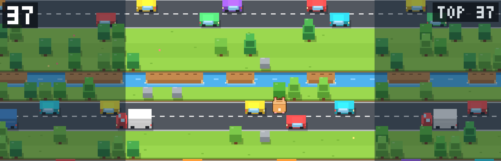

# Lane Hop (iDrive 7)

A lane-crossing arcade game for the centre display, **playable only while the car is parked**.
Hop a little hamster up the screen across grass, roads, rivers and railway lines, as far as you can.



It's drawn in a raised 3/4 view: cars, trees, logs, trains and the hamster are chunky pixel-art
blocks with a lit top, a darker front and a shadow. Forward is up the screen; the play area is the
bright strip in the middle, and the dimmed scenery either side is out of bounds.

Lanes come in groups, usually with grass to rest on between them:

| Lane | What happens |
|---|---|
| Grass | Safe. Trees and rocks block single cells. |
| Road | One to four lanes of cars and trucks driving left or right. Get hit and it's over. |
| River | Logs float left or right, with neighbouring lanes flowing opposite ways. Stand on a log or you sink. Ride one out of the play area and you're swept away. |
| Rail | A light flashes, then a fast train comes through. |

Your score is how many lanes you get. The best score is saved on the car.

## Controls

| | iDrive controller | Touch |
|---|---|---|
| Hop forward (up) | Press, or tilt up | Tap, or swipe up |
| Hop left / right | Turn the knob, or tilt left / right | Swipe left / right |
| Hop back (down) | Tilt down | Swipe down |
| Start / play again | Press | Tap |

With mgu-render's controller gate installed, the game holds the whole controller while
you play. Without it, the HMI keeps tilt up (its menu) and tilt left (BACK): press to hop
forward, and the knob, tilt right and tilt down still work.

## Install

1. Push this repo to GitHub. If it's already a source in the Store, its next check offers the new app.
2. Store → **Lane Hop** → Install. This also installs **mgu-render** if it's missing (`needs: renderer`).
3. If mgu-render was just installed, **restart the head unit** (Store → Settings → Restart head unit).
   mgu-render's in-page (embed) drawing starts working from the next boot. Until then the game draws on its own layer.

## Safety

The game page opens and stays open only while Vehicle2's speed reads below 3 km/h, with a
reading less than 3 s old (`src/speed.js`, the same rule as AirPlay Mirror). When the car
moves or the speed signal goes quiet, the game pauses, the controller and touch go back to
the HMI, and the app returns to its main page, which says *Lane Hop is available when parked*.
Your game is kept, so **Play** continues it once you've stopped.

## Layout

```
mgu-app.json                id, version, modules, the oap-sdk names they use
src/lanehop.js              the app: pages, parked gate, renderer, controller, touch, best score
src/game.js                 the rules (no car APIs): lanes, moves, collisions, score
src/draw.js                 a frame as mgu-render draw ops (CLEAR + RECT pixel art in 3/4 view, 30-60 KB a frame)
src/speed.js                "parked", from Vehicle2's speed (copied from daniel_airplay)
src/mgu_render_client.js    the renderer's client (copied from mgu-store)
package/                    the staged package (manifest/permissions copied from the Store app)
tools/gen_rhmi.js           the page table: ST_Lanehop_Main, _Embed, _Layer
tools/make_icon.js          draws the tile icon
tools/check.js              offline checks before you push
tools/test_game.js          the rules: passable worlds, safe start, lane groups, collisions, fairness
tools/sim.js                runs the app on your PC against a stand-in HMI, speed and renderer
tools/preview.js            draws frames to PNG (sim-out/) the way mgu-render would
tools/build.js              packs it with mgu-store's own linker
```

## Working on it

```sh
cd apps/daniel_lanehop
node tools/gen_rhmi.js      # after editing the page table
node tools/check.js         # names, ids, texts, versions, Node 8 syntax, icon
node tools/test_game.js     # the game's rules
node tools/sim.js           # the app against a simulated car and renderer
node tools/preview.js       # see frames in sim-out/
```

Bump `version` in `mgu-app.json`, `package/package.json` and `package/rhmiData/application.json`
together when you release (the car only installs a higher version).

## Not tested on a car yet

Everything above runs on a PC against stand-ins, not BMW's SDK or the real renderer. On the
first run in the car, check:

- the game fills the page and the pixel art isn't stretched (the field is scaled to the box height);
- the controller: knob direction, tilts, and the press (with and without the controller gate);
- touch: taps and swipes land where you expect;
- moving off closes the game (try a slow roll in a car park).

Logs: the app's `logger` lines (DLT, logging id `LHOP`), and `journalctl -u mgu-render`.
